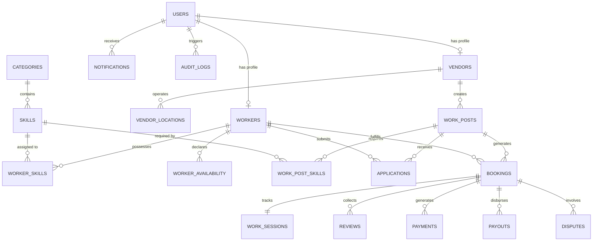

# Database Architecture & Schema Specification — KaamHour

## 1. Database Overview & Technology
* **Engine:** PostgreSQL 15+ (Supabase)
* **ORM:** Drizzle ORM (TypeScript type-safe schema definitions)
* **Design Philosophy:** Strict referential integrity, check constraints for state machines, composite unique indexes to prevent double-booking/duplicate applications, and spatial indexing for distance calculations.

---

## 2. Entity Relationship Diagram (ERD)

---

## 3. Schema Definitions & Table Catalog

### 3.1 `users`
Core user identity linking to Supabase Auth (`auth.users.id`).
* `id` (UUID, PK, references `auth.users(id)`)
* `email` (VARCHAR(255), UNIQUE, NOT NULL)
* `phone` (VARCHAR(20), UNIQUE, NOT NULL)
* `full_name` (VARCHAR(255), NOT NULL)
* `role` (ENUM: `'worker'`, `'vendor'`, `'admin'`, NOT NULL)
* `status` (ENUM: `'active'`, `'suspended'`, `'pending_verification'`, DEFAULT `'active'`)
* `avatar_url` (TEXT)
* `created_at` (TIMESTAMPTZ, DEFAULT NOW())
* `updated_at` (TIMESTAMPTZ, DEFAULT NOW())

### 3.2 `workers`
Worker-specific profile with platform-calculated verification metrics.
* `id` (UUID, PK, references `users(id)`)
* `bio` (TEXT)
* `approx_latitude` (DOUBLE PRECISION, NOT NULL)
* `approx_longitude` (DOUBLE PRECISION, NOT NULL)
* `approx_address` (TEXT)
* `service_radius_km` (INTEGER, DEFAULT 10)
* `total_hours_worked` (NUMERIC(8, 2), DEFAULT 0.00) -- Platform verified
* `shifts_completed` (INTEGER, DEFAULT 0) -- Platform verified
* `on_time_rate` (NUMERIC(5, 2), DEFAULT 100.00) -- Platform verified
* `completion_rate` (NUMERIC(5, 2), DEFAULT 100.00) -- Platform verified
* `average_rating` (NUMERIC(3, 2), DEFAULT 0.00) -- Platform verified
* `review_count` (INTEGER, DEFAULT 0)
* `repeat_hires_count` (INTEGER, DEFAULT 0)
* `kyc_status` (ENUM: `'unverified'`, `'submitted'`, `'verified'`, `'rejected'`, DEFAULT `'unverified'`)
* `created_at` (TIMESTAMPTZ, DEFAULT NOW())
* `updated_at` (TIMESTAMPTZ, DEFAULT NOW())

### 3.3 `vendors`
Business profile for restaurants, cafes, cloud kitchens, etc.
* `id` (UUID, PK, references `users(id)`)
* `business_name` (VARCHAR(255), NOT NULL)
* `business_type` (ENUM: `'restaurant'`, `'cafe'`, `'cloud_kitchen'`, `'bakery'`, `'food_stall'`, `'catering'`, `'banquet'`, `'retail'`, `'other'`, NOT NULL)
* `gstin_or_fssai` (VARCHAR(50))
* `verification_status` (ENUM: `'unverified'`, `'pending'`, `'verified'`, `'rejected'`, DEFAULT `'unverified'`)
* `average_rating` (NUMERIC(3, 2), DEFAULT 0.00)
* `total_shifts_posted` (INTEGER, DEFAULT 0)
* `total_spend` (NUMERIC(12, 2), DEFAULT 0.00)
* `created_at` (TIMESTAMPTZ, DEFAULT NOW())
* `updated_at` (TIMESTAMPTZ, DEFAULT NOW())

### 3.4 `vendor_locations`
Specific physical store/kitchen addresses where shifts take place.
* `id` (UUID, PK, DEFAULT gen_random_uuid())
* `vendor_id` (UUID, NOT NULL, references `vendors(id)` ON DELETE CASCADE)
* `location_name` (VARCHAR(255), NOT NULL) -- e.g. "Indiranagar Branch Kitchen"
* `address_line1` (TEXT, NOT NULL)
* `address_line2` (TEXT)
* `city` (VARCHAR(100), NOT NULL)
* `pincode` (VARCHAR(10), NOT NULL)
* `latitude` (DOUBLE PRECISION, NOT NULL)
* `longitude` (DOUBLE PRECISION, NOT NULL)
* `is_primary` (BOOLEAN, DEFAULT FALSE)
* `created_at` (TIMESTAMPTZ, DEFAULT NOW())

### 3.5 `categories` & `skills`
Extensible taxonomy for work categories and verifiable skills.
* **`categories`**: `id` (UUID, PK), `name` (VARCHAR(100)), `slug` (VARCHAR(100), UNIQUE), `icon` (VARCHAR(50)), `is_active` (BOOLEAN, DEFAULT TRUE)
* **`skills`**: `id` (UUID, PK), `category_id` (UUID, references `categories(id)`), `name` (VARCHAR(100)), `slug` (VARCHAR(100), UNIQUE), `description` (TEXT)
* **`worker_skills`**: `worker_id` (UUID), `skill_id` (UUID), `accumulated_hours` (NUMERIC(8,2), DEFAULT 0), `is_self_declared` (BOOLEAN, DEFAULT TRUE), `is_platform_verified` (BOOLEAN, DEFAULT FALSE), PRIMARY KEY (`worker_id`, `skill_id`)

### 3.6 `worker_availability`
Weekly recurring slots or specific date blackout blocks.
* `id` (UUID, PK, DEFAULT gen_random_uuid())
* `worker_id` (UUID, NOT NULL, references `workers(id)` ON DELETE CASCADE)
* `day_of_week` (INTEGER, CHECK (day_of_week BETWEEN 0 AND 6))
* `start_time` (TIME, NOT NULL)
* `end_time` (TIME, NOT NULL)
* `is_available` (BOOLEAN, DEFAULT TRUE)
* `override_date` (DATE) -- If specific date blackout/availability

### 3.7 `work_posts`
Hourly shift postings created by vendors.
* `id` (UUID, PK, DEFAULT gen_random_uuid())
* `vendor_id` (UUID, NOT NULL, references `vendors(id)` ON DELETE CASCADE)
* `location_id` (UUID, NOT NULL, references `vendor_locations(id)`)
* `category_id` (UUID, NOT NULL, references `categories(id)`)
* `title` (VARCHAR(255), NOT NULL)
* `description` (TEXT, NOT NULL)
* `workers_needed` (INTEGER, NOT NULL, CHECK (workers_needed > 0))
* `workers_confirmed` (INTEGER, NOT NULL, DEFAULT 0)
* `shift_date` (DATE, NOT NULL)
* `start_time` (TIME, NOT NULL)
* `end_time` (TIME, NOT NULL)
* `duration_hours` (NUMERIC(4, 2), NOT NULL)
* `hourly_wage` (NUMERIC(8, 2), NOT NULL, CHECK (hourly_wage >= 50)) -- In INR
* `estimated_total_cost` (NUMERIC(10, 2), NOT NULL) -- workers_needed * duration_hours * hourly_wage
* `instructions` (TEXT)
* `status` (ENUM: `'draft'`, `'published'`, `'filled'`, `'in_progress'`, `'completed'`, `'cancelled'`, DEFAULT `'published'`)
* `created_at` (TIMESTAMPTZ, DEFAULT NOW())
* `updated_at` (TIMESTAMPTZ, DEFAULT NOW())

### 3.8 `work_post_skills`
* `work_post_id` (UUID, references `work_posts(id)` ON DELETE CASCADE)
* `skill_id` (UUID, references `skills(id)` ON DELETE CASCADE)
* PRIMARY KEY (`work_post_id`, `skill_id`)

### 3.9 `applications`
Worker applications for specific shifts.
* `id` (UUID, PK, DEFAULT gen_random_uuid())
* `work_post_id` (UUID, NOT NULL, references `work_posts(id)` ON DELETE CASCADE)
* `worker_id` (UUID, NOT NULL, references `workers(id)` ON DELETE CASCADE)
* `status` (ENUM: `'pending'`, `'accepted'`, `'rejected'`, `'withdrawn'`, DEFAULT `'pending'`)
* `match_score` (INTEGER, NOT NULL) -- Calculated 0-100 by matching engine
* `match_reasons` (JSONB, NOT NULL) -- Explanations (skills, distance, rating)
* `applied_at` (TIMESTAMPTZ, DEFAULT NOW())
* `responded_at` (TIMESTAMPTZ)
* UNIQUE (`work_post_id`, `worker_id`)

### 3.10 `bookings`
Locked agreement for a worker to perform a shift.
* `id` (UUID, PK, DEFAULT gen_random_uuid())
* `work_post_id` (UUID, NOT NULL, references `work_posts(id)`)
* `worker_id` (UUID, NOT NULL, references `workers(id)`)
* `vendor_id` (UUID, NOT NULL, references `vendors(id)`)
* `application_id` (UUID, references `applications(id)`)
* `hourly_wage` (NUMERIC(8, 2), NOT NULL)
* `scheduled_start` (TIMESTAMPTZ, NOT NULL)
* `scheduled_end` (TIMESTAMPTZ, NOT NULL)
* `status` (ENUM: `'pending'`, `'confirmed'`, `'checked_in'`, `'in_progress'`, `'completed'`, `'cancelled'`, `'disputed'`, DEFAULT `'confirmed'`)
* `created_at` (TIMESTAMPTZ, DEFAULT NOW())
* `updated_at` (TIMESTAMPTZ, DEFAULT NOW())
* UNIQUE (`work_post_id`, `worker_id`)

### 3.11 `work_sessions`
Live execution record of check-in, check-out, and actual logged hours.
* `id` (UUID, PK, DEFAULT gen_random_uuid())
* `booking_id` (UUID, UNIQUE, NOT NULL, references `bookings(id)` ON DELETE CASCADE)
* `worker_check_in_at` (TIMESTAMPTZ)
* `worker_check_in_lat` (DOUBLE PRECISION)
* `worker_check_in_lng` (DOUBLE PRECISION)
* `vendor_verified_start_at` (TIMESTAMPTZ)
* `worker_check_out_at` (TIMESTAMPTZ)
* `vendor_verified_end_at` (TIMESTAMPTZ)
* `actual_hours` (NUMERIC(4, 2)) -- Calculated from verified timestamps
* `status` (ENUM: `'scheduled'`, `'checked_in'`, `'in_progress'`, `'completed'`, `'disputed'`, DEFAULT `'scheduled'`)
* `notes` (TEXT)
* `created_at` (TIMESTAMPTZ, DEFAULT NOW())
* `updated_at` (TIMESTAMPTZ, DEFAULT NOW())

### 3.12 `reviews`
Bilateral reviews between worker and vendor after shift completion.
* `id` (UUID, PK, DEFAULT gen_random_uuid())
* `booking_id` (UUID, NOT NULL, references `bookings(id)`)
* `author_id` (UUID, NOT NULL, references `users(id)`)
* `target_id` (UUID, NOT NULL, references `users(id)`)
* `review_type` (ENUM: `'worker_to_vendor'`, `'vendor_to_worker'`, NOT NULL)
* `rating` (INTEGER, NOT NULL, CHECK (rating BETWEEN 1 AND 5))
* `comment` (TEXT)
* `created_at` (TIMESTAMPTZ, DEFAULT NOW())
* UNIQUE (`booking_id`, `author_id`)

### 3.13 `payments` & `payouts`
Financial transactions and worker disbursements.
* **`payments`**: `id` (UUID, PK), `booking_id` (UUID, references `bookings(id)`), `vendor_id` (UUID, references `vendors(id)`), `razorpay_order_id` (VARCHAR(100)), `razorpay_payment_id` (VARCHAR(100)), `amount` (NUMERIC(10, 2), NOT NULL), `platform_fee` (NUMERIC(8, 2), DEFAULT 0), `currency` (VARCHAR(10), DEFAULT `'INR'`), `status` (ENUM: `'created'`, `'authorized'`, `'captured'`, `'failed'`, `'refunded'`, DEFAULT `'created'`), `created_at` (TIMESTAMPTZ, DEFAULT NOW())
* **`payouts`**: `id` (UUID, PK), `booking_id` (UUID, references `bookings(id)`), `worker_id` (UUID, references `workers(id)`), `amount` (NUMERIC(10, 2), NOT NULL), `payout_method` (ENUM: `'upi'`, `'bank_transfer'`), `payout_reference` (VARCHAR(100)), `status` (ENUM: `'pending'`, `'processing'`, `'completed'`, `'failed'`, DEFAULT `'pending'`), `disbursed_at` (TIMESTAMPTZ)

### 3.14 `notifications`, `disputes`, `audit_logs`
* **`notifications`**: `id` (UUID, PK), `user_id` (UUID, references `users(id)`), `title` (VARCHAR(255)), `message` (TEXT), `type` (VARCHAR(50)), `data` (JSONB), `is_read` (BOOLEAN, DEFAULT FALSE), `created_at` (TIMESTAMPTZ, DEFAULT NOW())
* **`disputes`**: `id` (UUID, PK), `booking_id` (UUID, references `bookings(id)`), `raised_by_id` (UUID, references `users(id)`), `reason` (TEXT), `evidence_urls` (JSONB), `status` (ENUM: `'open'`, `'under_investigation'`, `'resolved_refund'`, `'resolved_payout'`, `'rejected'`, DEFAULT `'open'`), `resolution_notes` (TEXT), `resolved_by` (UUID, references `users(id)`), `created_at` (TIMESTAMPTZ, DEFAULT NOW())
* **`audit_logs`**: `id` (UUID, PK), `user_id` (UUID), `action` (VARCHAR(100)), `entity_type` (VARCHAR(50)), `entity_id` (UUID), `metadata` (JSONB), `ip_address` (VARCHAR(45)), `created_at` (TIMESTAMPTZ, DEFAULT NOW())
