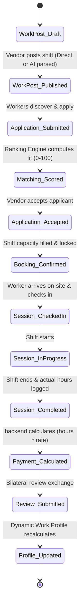

# Hyperlocal Hourly Workforce Marketplace — Product Specification (KaamHour)

## 1. Product Overview & Executive Summary

**Product Name:** KaamHour (Hourly Workforce Marketplace)  
**Core Value Proposition:** 
* *For Businesses:* "Get reliable, verified workers exactly when you need them — pay only for the exact hours required."
* *For Workers:* "Find flexible hourly shifts near you, earn transparent wages, and build an untamperable verified work identity."

### 1.1 The Core Problem
Small and local businesses (especially in food and hospitality) face extreme demand volatility during specific peak windows (e.g., lunch rush 12:00 PM – 3:30 PM, dinner rush 7:00 PM – 11:00 PM, weekend banquet preparations).
Hiring full-time or full-day workers causes high fixed overheads, underutilization during lull hours, and sudden shortages during peak rushes.
Concurrently, millions of informal and semi-skilled workers seek flexible, predictable supplementary hourly income without locking into restrictive monthly contracts.

### 1.2 Target Launch Market (Vertical 1: Food & Hospitality)
* **Target Businesses:** Standalone restaurants, cafes, cloud kitchens, bakeries, food stalls, catering services, sweet shops, banquet halls.
* **Initial Job Categories & Skills:**
  - Kitchen Helper / Commis Support
  - Waiter / Table Service
  - Deep Cleaning & Dishwashing (Stewarding)
  - Food Preparation & Chopping
  - Order Packaging & Dispatch Assembly
  - Counter Service & Billing Assist
  - Loading / Unloading / Raw Material Stocking
  - Event Catering & Banquet Assistance
* **Extensibility:** The data architecture is modular and category-agnostic to support future expansion into Retail, Warehousing, Event Logistics, Light Manufacturing, and Local Delivery.

---

## 2. Key Differentiator: The Dynamic Work Profile

Traditional resumes and self-declared profiles are unreliable in informal hourly labor. KaamHour introduces the **Dynamic Work Profile**, where credentials and badges are generated automatically from **platform-verified transaction history**.

### 2.1 Profile Anatomy & Verification Boundary
```
+--------------------------------------------------------------------+
| RAHUL PATIL                      [Platform Verified Worker]        |
| Overall Rating: ★★★★★ 4.79 (48 Reviews)                            |
| 326 Verified Hours Worked  |  47 Shifts Completed                  |
| 94% On-Time Check-in Rate  |  97% Shift Completion Rate            |
| 18 Repeat Hires (from 6 unique vendors)                            |
+--------------------------------------------------------------------+
| VERIFIED SKILLS & ACCUMULATED HOURS                                |
| • Kitchen Assistance: 142 Hours (24 shifts)                        |
| • Packaging & Assembly: 88 Hours (12 shifts)                       |
| • Deep Cleaning & Stewarding: 56 Hours (7 shifts)                  |
| • Food Prep: 40 Hours (4 shifts)                                   |
+--------------------------------------------------------------------+
| RECENT WORK HISTORY (Immutable Platform Logs)                      |
| • Kitchen Helper @ Shree Snacks | 4.0 hrs | ★★★★★ "Very punctual"  |
| • Packaging @ Royal Cloud Kitchen | 5.0 hrs | ★★★★★ "Handled rush" |
| • Dishwashing @ Cafe Mocha | 3.5 hrs | ★★★★☆ "Good hygiene"       |
+--------------------------------------------------------------------+
| SELF-DECLARED INFO (Clearly Separated)                             |
| • Languages: Hindi, Marathi, Basic English                         |
| • Preferred Work Radius: Up to 5 km                                |
| • Availability Preference: Evening (6 PM - 12 AM)                  |
+--------------------------------------------------------------------+
```

### 2.2 Mathematical Metrics Computation
1. **Verified Total Hours:** $\sum \text{actual\_hours}$ across all `completed` work sessions.
2. **On-Time Rate:** $\frac{\text{Shifts with } (\text{actual\_check\_in} \le \text{scheduled\_start} + 10\text{ min})}{\text{Total Started Shifts}} \times 100\%$
3. **Completion Rate:** $\frac{\text{Completed Shifts}}{\text{Total Confirmed Bookings} - \text{Vendor Cancelled Bookings}} \times 100\%$
4. **Repeat Hire Index:** Count of distinct shifts booked by vendors who have booked the same worker $\ge 2$ times.
5. **Skill-Specific Hours:** Accumulated strictly from completed shifts tagged with that specific skill taxonomy.

---

## 3. User Roles & Permissions

| Role | Target Persona | Primary Responsibilities & Permissions |
| :--- | :--- | :--- |
| **Worker** | Local hourly wage earner, student, part-timer | Discover nearby shifts, apply, manage availability, check in/out with geolocation verification, track earnings & payouts, view dynamic profile. |
| **Vendor** | Restaurant owner, manager, caterer | Post hourly shifts (manual or AI natural language), review scored applicant matches, confirm bookings, verify worker check-in, review worker performance, pay hourly invoices. |
| **Admin** | Platform operations team, compliance officer | Verify business KYC, audit dispute logs, suspend fraudulent actors, inspect system metrics, manage platform fee parameters. |

---

## 4. End-to-End Operational Lifecycle State Machine



---

## 5. Explainable Deterministic Matching Engine

Every worker-to-shift pairing is scored on a normalized scale (0–100) with explainable reasoning:
* **30% Skill Compatibility:** Exact skill match score + adjacency.
* **20% Proximity (Distance):** Haversine / PostGIS distance decay function ($100\%$ at $<1\text{km}$, linearly decreasing to $0\%$ at $>15\text{km}$).
* **20% Real-Time Availability:** Absence of overlapping active bookings or blackout periods.
* **15% Reliability & Completion Rate:** Platform verified historical on-time and completion percentage.
* **10% Average Customer Rating:** Normalized 1–5 star rating history.
* **5% Similar Shift Experience:** Historical hours accumulated in the requested category.

---

## 6. Financial & Payment Lifecycle Architecture
* **Calculation:** $\text{Invoice Amount} = (\text{Actual Verified Hours} \times \text{Hourly Rate}) + \text{Platform Fee}$.
* **Escrow / Authorization:** Vendor commits booking; upon shift completion, hours are validated by the manager and payment is processed via Razorpay integration.
* **Payout Architecture:** Direct worker bank transfer / UPI payout batching records with immutable transaction ledgers and dispute hold mechanisms.
